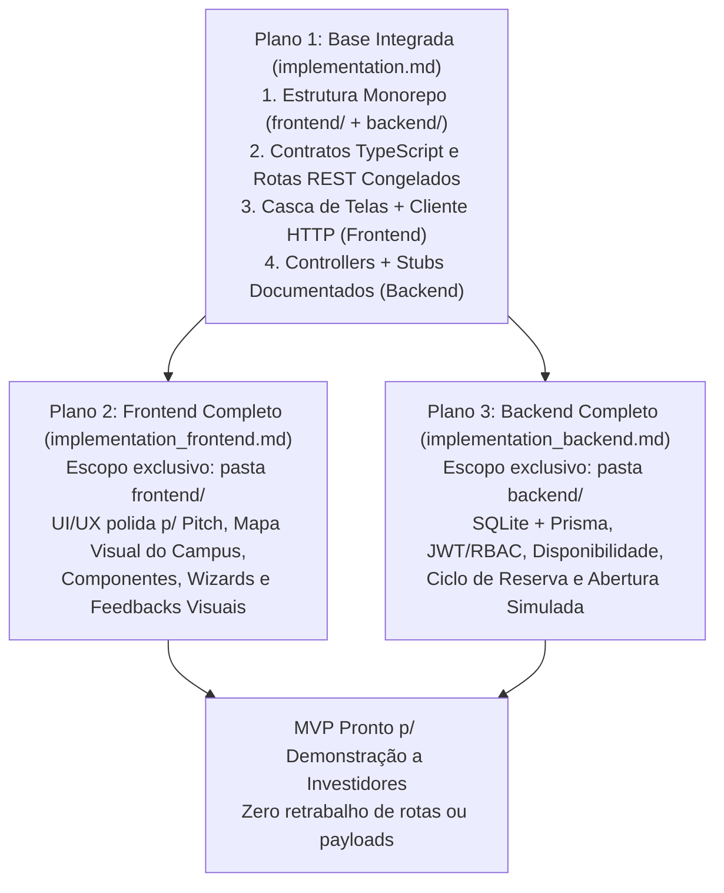

# Plano de Implementação 1 — Base do Sistema, Casca de Interfaces e Contratos de API

> **Foco Estratégico do MVP (Apresentação para Investidores):**
> O objetivo deste MVP é entregar um **aplicativo funcional, fluido e demonstrável** para que potenciais investidores e parceiros compreendam na prática a proposta de valor e o modelo de negócio do **UniLocker**.
> - **Fora de escopo neste momento:** Gateways de pagamento reais/webhooks complexos, comunicação física IoT com fechaduras reais, conciliação bancária, serviços de nuvem (S3/Push/E-mail) ou APIs externas pagas.
> - **Como funciona no MVP:** A contratação no checkout ativa a reserva instantaneamente (sem fricção de pagamento externo), a abertura do locker é demonstrada visualmente na interface com registro de auditoria no servidor, e o demonstrativo de receitas/comissões (modelo 90% Parceiro / 10% UniLocker) é calculado diretamente a partir dos aluguéis realizados.

> **Papel deste documento:** Este é o **Plano 1 (Fundação Integrada)**. Ele cria a estrutura do repositório, congela os contratos de comunicação (DTOs, rotas e enums), ergue a **casca navegável de todas as telas no Frontend** e disponibiliza **todos os endpoints no Backend** conectados a funções *stub/mock* documentadas.
>
> Após a conclusão deste plano, o desenvolvimento segue em paralelo sem gargalos:
> - **Frontend Autônomo:** [`.agents/implementation_frontend.md`](./implementation_frontend.md) (atua exclusivamente na pasta `frontend/`)
> - **Backend Autônomo:** [`.agents/implementation_backend.md`](./implementation_backend.md) (atua exclusivamente na pasta `backend/`)

---

## 1. Visão Geral da Estratégia de Paralelização



### Princípios Inegociáveis desta Fase Base
1. **Contrato Congelado (*API-First*):** Os caminhos dos endpoints, métodos HTTP, nomes de campos JSON e *enums* definidos na Seção 3 são a referência única entre Frontend e Backend.
2. **Isolamento Físico de Pastas:**
   - Tudo de interface vive em `/frontend` (porta `5173`).
   - Tudo de servidor e banco vive em `/backend` (porta `3000`, prefixo global `/api`).
3. **Zero Dependência de APIs Externas:** Todo o sistema roda 100% localmente e offline-friendly, ideal para apresentações ao vivo sem risco de falha de serviços de terceiros.

---

## 2. Stack Tecnológica e Estrutura de Diretórios

### 2.1. Tecnologias Definidas para o MVP
- **Frontend (`/frontend`):** React 18 + Vite + TypeScript + Tailwind CSS v4 + React Router v6 + Axios + Lucide React (ícones). Aplicativo Web Responsivo Único contemplando layout *Mobile-First* para **Usuário** e **Parceiro**, e layout *Desktop Sidebar* para **Administrador**.
- **Backend (`/backend`):** Node.js + TypeScript + NestJS + CORS habilitado. Na Fase 1 opera com dados *in-memory* nos *Services* (`MockDbService`); no Plano 3 recebe persistência local em **SQLite via Prisma ORM**.

### 2.2. Árvore de Diretórios Alvo (Plano 1)

```text
UniLocker/
├── .agents/
│   ├── agents.md
│   ├── backend.md
│   ├── frontend.md
│   ├── implementation.md            # (Este arquivo) Plano 1: Base + Contratos
│   ├── implementation_frontend.md   # Plano 2: Evolução isolada do Frontend
│   ├── implementation_backend.md    # Plano 3: Evolução isolada do Backend
│   └── tasks.md                     # Checklist geral e paralelo de tarefas
├── backend/
│   ├── src/
│   │   ├── main.ts                  # Prefixo /api, CORS p/ localhost, porta 3000
│   │   ├── app.module.ts
│   │   ├── common/
│   │   │   ├── auth/
│   │   │   │   └── mock-auth.guard.ts # Guard + @Public, @Roles, @CurrentUser
│   │   │   ├── contracts/
│   │   │   │   └── api.contracts.ts   # Tipos, Enums e DTOs congelados
│   │   │   └── mock/
│   │   │       └── mock-db.service.ts # Estado inicial em memória c/ personas UFRJ
│   │   ├── auth/                    # AuthController + AuthService (stub)
│   │   ├── users/                   # UsersController + UsersService (stub)
│   │   ├── locations/               # LocationsController + LocationsService (stub)
│   │   ├── reservations/            # ReservationsController + ReservationsService (stub)
│   │   ├── access/                  # AccessController + AccessService (simulação de abertura)
│   │   ├── partners/                # PartnersController + PartnersService (pontos e receita)
│   │   ├── support/                 # SupportController + SupportService (chamados)
│   │   └── admin/                   # AdminController + AdminService (aprovações e visão global)
│   ├── package.json
│   └── tsconfig.json
└── frontend/
    ├── .env.example                 # VITE_API_URL=http://localhost:3000/api
    ├── src/
    │   ├── main.tsx
    │   ├── App.tsx                  # Rotas (Public, User, Partner, Admin)
    │   ├── types/
    │   │   └── api.ts               # Espelho exato de api.contracts.ts
    │   ├── contexts/
    │   │   └── AuthContext.tsx      # Sessão + Seletor Rápido de Persona p/ Pitch
    │   ├── components/
    │   │   ├── DemoPersonaSwitcher.tsx
    │   │   ├── RequireAuth.tsx
    │   │   └── ui.tsx
    │   ├── layouts/
    │   │   ├── UserMobileLayout.tsx # Bottom Nav: Explorar, Minhas Reservas, Ajuda, Perfil
    │   │   ├── PartnerLayout.tsx    # Nav Parceiro: Painel, Novo Ponto, Aluguéis, Receitas
    │   │   └── AdminWebLayout.tsx   # Sidebar Web: Visão Geral, Usuários, Parceiros, Pontos, Reservas, Ocorrências
    │   ├── services/
    │   │   ├── http.ts
    │   │   ├── auth.service.ts
    │   │   ├── locations.service.ts
    │   │   ├── reservations.service.ts
    │   │   ├── access.service.ts
    │   │   ├── partner.service.ts
    │   │   ├── support.service.ts
    │   │   └── admin.service.ts
    │   └── pages/                   # Cascas funcionais conectadas aos services
    │       ├── auth/                # WelcomePage, LoginPage, RegisterPage
    │       ├── user/                # ExplorePage, LocationDetailPage, CheckoutPage,
    │       │                        # MyReservationsPage, ActiveReservationPage, LockerLocatePage,
    │       │                        # SupportPage, ProfilePage
    │       ├── partner/             # PartnerApplyPage, PartnerDashboardPage, CreateLocationPage,
    │       │                        # ManageLockersPage, PartnerReservationsPage, PartnerFinancialPage
    │       └── admin/               # AdminDashboardPage, AdminUsersPage, AdminPartnersPage,
    │                                # AdminLocationsPage, AdminReservationsPage, AdminIncidentsPage
    ├── package.json
    └── tsconfig.json
```

---

## 3. Contrato de Dados e Enums Congelados (`api.contracts.ts` / `api.ts`)

Estes tipos são idênticos em `backend/src/common/contracts/api.contracts.ts` e `frontend/src/types/api.ts`.

```typescript
// ==================== ENUMS ====================

export type UserRole = 'USER' | 'PARTNER' | 'ADMIN';
export type PartnerStatus = 'PENDING' | 'APPROVED' | 'REJECTED';
export type LocationStatus = 'DRAFT' | 'PENDING_APPROVAL' | 'ACTIVE' | 'INACTIVE' | 'REJECTED';
export type LockerSize = 'SMALL' | 'MEDIUM' | 'LARGE';
export type LockerStatus = 'AVAILABLE' | 'OCCUPIED' | 'MAINTENANCE' | 'BLOCKED';
export type RentalPeriod = 'DAILY' | 'WEEKLY' | 'MONTHLY';

export type ReservationStatus =
  | 'Active'
  | 'Completed'
  | 'Cancelled'
  | 'Expired'
  | 'Incident';

export type AccessAction = 'UNLOCK_REQUEST' | 'EMERGENCY_UNLOCK';
export type AccessResult = 'CONFIRMED' | 'UNAUTHORIZED' | 'LOCKER_MAINTENANCE';

export type TicketCategory =
  | 'LOCKER_WONT_OPEN'
  | 'LOCKER_DAMAGED'
  | 'ITEMS_TRAPPED'
  | 'EXPIRED_RENTAL'
  | 'OTHER';

export type TicketStatus = 'OPEN' | 'IN_PROGRESS' | 'RESOLVED' | 'CLOSED';
export type TicketPriority = 'LOW' | 'MEDIUM' | 'HIGH';

// ==================== ENTIDADES / DTOs DE RESPOSTA ====================

export interface UserDto {
  id: string;
  name: string;
  email: string;
  universityAffiliation: string;
  roles: UserRole[];
  partnerId?: string | null;
  partnerStatus?: PartnerStatus | null;
  createdAt: string;
}

export interface AuthResponseDto {
  accessToken: string;
  user: UserDto;
}

export interface PricingPlanDto {
  id: string;
  locationId: string;
  size: LockerSize;
  period: RentalPeriod;
  priceCents: number; // Em centavos (ex: 800 = R$ 8,00)
}

export interface LockerDto {
  id: string;
  locationId: string;
  code: string;         // Ex: "B-05"
  size: LockerSize;
  status: LockerStatus;
}

export interface LocationSummaryDto {
  id: string;
  partnerId: string;
  partnerName: string;
  name: string;
  campus: string;
  building: string;
  block: string;
  floor: string;
  reference: string;
  latitude: number;
  longitude: number;
  openingHours: string;
  photoUrls: string[];
  availableCount: number;
  startingDailyPriceCents: number;
  status: LocationStatus;
}

export interface LocationDetailDto extends LocationSummaryDto {
  roomOrCorridor: string;
  accessInstructions: string;
  usageRules: string;
  pricingPlans: PricingPlanDto[];
  availableBySize: Record<LockerSize, number>;
  lockers?: LockerDto[];
}

export interface ReservationDto {
  id: string;
  userId: string;
  userName?: string;
  locationId: string;
  locationName: string;
  buildingSummary: string;
  accessInstructions: string;
  lockerId: string;
  lockerCode: string;
  size: LockerSize;
  period: RentalPeriod;
  startTime: string;
  endTime: string;
  status: ReservationStatus;
  totalPriceCents: number;
  createdAt: string;
}

export interface AccessEventDto {
  id: string;
  reservationId: string;
  lockerId: string;
  lockerCode: string;
  action: AccessAction;
  result: AccessResult;
  message: string;
  createdAt: string;
}

export interface SupportTicketDto {
  id: string;
  userId: string;
  userName: string;
  reservationId?: string | null;
  lockerCode?: string | null;
  category: TicketCategory;
  priority: TicketPriority;
  description: string;
  status: TicketStatus;
  adminNotes?: string | null;
  createdAt: string;
  updatedAt: string;
}

export interface PartnerDto {
  id: string;
  userId: string;
  organizationName: string;
  organizationType: string;
  responsibleName: string;
  contactPhone: string;
  status: PartnerStatus;
  createdAt: string;
}

/** Demonstrativo simplificado de receita por aluguel (90% Parceiro / 10% Taxa UniLocker). */
export interface PartnerRevenueEntryDto {
  reservationId: string;
  locationName: string;
  lockerCode: string;
  period: RentalPeriod;
  grossAmountCents: number;
  platformFeeCents: number;
  partnerNetCents: number;
  createdAt: string;
}

export interface PartnerDashboardDto {
  partner: PartnerDto;
  totalLockers: number;
  occupiedLockers: number;
  availableLockers: number;
  maintenanceLockers: number;
  activeRentals: number;
  periodRevenueCents: number;
  pendingIncidents: number;
  locations: LocationSummaryDto[];
}

export interface PartnerFinancialSummaryDto {
  grossTotalCents: number;
  platformCommissionCents: number;
  partnerNetTotalCents: number;
  totalRentalsCount: number;
  revenueByLocation: { locationId: string; locationName: string; revenueCents: number }[];
  revenueByPeriod: Record<RentalPeriod, number>;
  entries: PartnerRevenueEntryDto[];
}

export interface AdminDashboardDto {
  totalUsers: number;
  activePartners: number;
  pendingPartners: number;
  totalLocations: number;
  pendingLocations: number;
  operationalLockers: number;
  activeRentals: number;
  grossRevenueCents: number;
  platformRevenueCents: number;
  openIncidents: number;
}
```

---

## 4. Mapa Completo dos 35 Endpoints Essenciais

Todos os endpoints respondem sob `http://localhost:3000/api`.

### 4.1. Autenticação e Usuários (`AuthModule` & `UsersModule`)
| Método e Rota | Payload (Body / Query) | Retorno | Ideia da Função no Backend |
| :--- | :--- | :--- | :--- |
| `POST /auth/register` | `{ name, email, password, universityAffiliation }` | `AuthResponseDto` | `authService.register()`: Valida e-mail único, cria conta `['USER']` e retorna sessão. |
| `POST /auth/login` | `{ email, password }` | `AuthResponseDto` | `authService.login()`: Autentica usuário (ou persona demo) e retorna token + `UserDto`. |
| `GET /users/me` | Header `Authorization` | `UserDto` | `usersService.getProfile()`: Retorna usuário autenticado com vínculo de parceiro se houver. |
| `PATCH /users/me` | `{ name?, universityAffiliation? }` | `UserDto` | `usersService.updateProfile()`: Atualiza nome e vínculo universitário. |

### 4.2. Descoberta de Pontos e Disponibilidade (`LocationsModule`)
| Método e Rota | Payload (Body / Query) | Retorno | Ideia da Função no Backend |
| :--- | :--- | :--- | :--- |
| `GET /locations` | Query: `campus?`, `search?`, `size?`, `period?`, `maxPriceCents?`, `onlyAvailable?` | `LocationSummaryDto[]` | `locationsService.findPublicLocations()`: Lista pontos `ACTIVE` calculando vagas livres e menor preço diário. |
| `GET /locations/:id` | Param `id` | `LocationDetailDto` | `locationsService.findPublicLocationById()`: Detalhes completos, fotos, horários, regras, `pricingPlans` e vagas por tamanho. |
| `GET /locations/:id/lockers` | Param `id` | `LockerDto[]` | `locationsService.listLocationLockers()`: Lista compartimentos vinculados ao ponto. |
| `GET /lockers/:id/availability` | Param `id`, Query `period?` | `{ available, reason?, priceCents? }` | `locationsService.checkLockerAvailability()`: Verifica se ponto está ativo e compartimento livre/operacional. |

### 4.3. Reservas com Ativação Direta no MVP (`ReservationsModule`)
| Método e Rota | Payload (Body / Query) | Retorno | Ideia da Função no Backend |
| :--- | :--- | :--- | :--- |
| `POST /reservations` | `{ locationId, size, period, lockerId? }` | `ReservationDto` | `reservationsService.createReservation()`: Verifica disponibilidade, escolhe automaticamente um locker compatível se `lockerId` omitido, calcula `totalPriceCents`, **ativa imediatamente a reserva (`Active`)** e ocupa o compartimento (`OCCUPIED`). |
| `GET /reservations/me` | Header `Authorization` | `{ active: ReservationDto[], history: ReservationDto[] }` | `reservationsService.listUserReservations()`: Separa aluguéis ativos/vencidos do histórico encerrado. |
| `GET /reservations/:id` | Param `id` | `ReservationDto` | `reservationsService.getReservationById()`: Detalhes da reserva e orientações de chegada ao compartimento. |
| `POST /reservations/:id/extend` | `{ additionalPeriod: RentalPeriod }` | `ReservationDto` | `reservationsService.extendReservation()`: Soma período adicional ao `endTime` e atualiza valor acumulado. |
| `POST /reservations/:id/complete` | `{ confirmedEmptyAndClosed: boolean }` | `ReservationDto` | `reservationsService.completeReservation()`: Exige confirmação de retirada dos pertences, encerra (`Completed`) e libera o locker (`AVAILABLE`). |
| `POST /reservations/:id/cancel` | — | `ReservationDto` | `reservationsService.cancelReservation()`: Cancela reserva elegível e libera o locker. |

### 4.4. Simulação de Abertura pelo App (`AccessModule`)
| Método e Rota | Payload (Body / Query) | Retorno | Ideia da Função no Backend |
| :--- | :--- | :--- | :--- |
| `POST /reservations/:id/unlock` | — | `AccessEventDto` | `accessService.requestUnlock()`: Verifica titularidade e reserva `Active`, registra evento de abertura e confirma destravamento para feedback visual imediato na tela. |
| `GET /reservations/:id/access-events` | Param `id` | `AccessEventDto[]` | `accessService.listAccessEvents()`: Histórico de aberturas realizadas na reserva. |

### 4.5. Área do Parceiro / Ofertador (`PartnersModule`)
| Método e Rota | Payload (Body / Query) | Retorno | Ideia da Função no Backend |
| :--- | :--- | :--- | :--- |
| `POST /partners/applications` | `{ organizationName, organizationType, responsibleName, contactPhone }` | `PartnerDto` | `partnersService.applyForPartner()`: Registra candidatura de ofertador (`PENDING`). |
| `GET /partner/dashboard` | Header `Authorization` | `PartnerDashboardDto` | `partnersService.getDashboard()`: Indicadores de ocupação, receita acumulada dos aluguéis e lista de pontos. |
| `POST /partner/locations` | `{ locationData, lockersData, pricingPlans }` | `LocationDetailDto` | `partnersService.createLocation()`: Cria ponto (`PENDING_APPROVAL`) com lockers iniciais e tabela de preços. |
| `PATCH /partner/locations/:id` | `{ openingHours?, accessInstructions?, usageRules?, pricingPlans? }` | `LocationDetailDto` | `partnersService.updateLocation()`: Atualiza horários, instruções, regras e preços do ponto. |
| `POST /partner/locations/:id/lockers` | `{ lockers: { code, size }[] }` | `LockerDto[]` | `partnersService.addLockers()`: Adiciona novos compartimentos ao ponto. |
| `PATCH /partner/lockers/:id` | `{ status: 'AVAILABLE' \| 'MAINTENANCE' \| 'BLOCKED' }` | `LockerDto` | `partnersService.updateLockerStatus()`: Altera status operacional (impedindo mudança se `OCCUPIED`). |
| `GET /partner/reservations` | Query `locationId?`, `status?` | `ReservationDto[]` | `partnersService.listPartnerReservations()`: Aluguéis nos pontos do ofertador. |
| `GET /partner/financial` | Header `Authorization` | `PartnerFinancialSummaryDto` | `partnersService.getFinancialSummary()`: Demonstrativo do modelo de negócio (Bruto, Comissão UniLocker 10%, Líquido Parceiro 90%) calculado sobre as reservas. |

### 4.6. Suporte e Ocorrências (`SupportModule`)
| Método e Rota | Payload (Body / Query) | Retorno | Ideia da Função no Backend |
| :--- | :--- | :--- | :--- |
| `POST /support/tickets` | `{ reservationId?, category, description }` | `SupportTicketDto` | `supportService.createTicket()`: Registra chamado operacional com priorização automática. |
| `GET /support/tickets/me` | Header `Authorization` | `SupportTicketDto[]` | `supportService.listMyTickets()`: Lista chamados do usuário e retorno da administração. |

### 4.7. Painel Administrativo (`AdminModule`)
| Método e Rota | Payload (Body / Query) | Retorno | Ideia da Função no Backend |
| :--- | :--- | :--- | :--- |
| `GET /admin/dashboard` | Header `Authorization` | `AdminDashboardDto` | `adminService.getOverview()`: Visão executiva (usuários, parceiros, lockers, aluguéis, receita total e comissão da plataforma). |
| `GET /admin/users` | Query `search?` | `UserDto[]` | `adminService.listUsers()`: Contas e vínculos universitários. |
| `GET /admin/partners/pending` | Query `includeAll?: boolean` | `PartnerDto[]` | `adminService.listPartners()`: Fila de aprovação de novos ofertadores. |
| `POST /admin/partners/:id/approve` | `{ approved: boolean }` | `PartnerDto` | `adminService.reviewPartner()`: Aprova ofertador (adicionando role `PARTNER`) ou rejeita. |
| `GET /admin/locations` | Query `status?` | `LocationDetailDto[]` | `adminService.listAllLocations()`: Todos os pontos da rede. |
| `POST /admin/locations/:id/approve` | `{ approved: boolean }` | `LocationDetailDto` | `adminService.reviewLocation()`: Publica ponto (`ACTIVE`) após conferência ou rejeita. |
| `GET /admin/reservations` | Query `status?`, `locationId?`, `userId?` | `ReservationDto[]` | `adminService.listAllReservations()`: Consulta global de aluguéis. |
| `GET /admin/incidents` | Query `status?` | `SupportTicketDto[]` | `adminService.listIncidents()`: Central de ocorrências e aluguéis vencidos. |
| `PATCH /admin/incidents/:id` | `{ status, adminNotes?, releaseLocker?: boolean }` | `SupportTicketDto` | `adminService.resolveIncident()`: Trata ocorrência e permite liberação controlada de compartimentos retidos. |

---

## 5. Critérios de Aceite do Plano 1

- [x] `backend` compila sem erros (`npm.cmd run build`) e responde em `http://localhost:3000/api`.
- [x] `frontend` compila sem erros (`npm.cmd run build`) e serve em `http://localhost:5173`.
- [x] Todos os endpoints mapeados na Seção 4 funcionam sobre o `MockDbService` com as personas UFRJ (*Cintra*, *Joaquim*, *Prof. Guilherme*, *Admin*).
- [x] Todas as 23 telas-casca de Usuário, Parceiro e Admin estão navegáveis e integradas aos endpoints, prontas para evolução paralela nos Planos 2 e 3.
